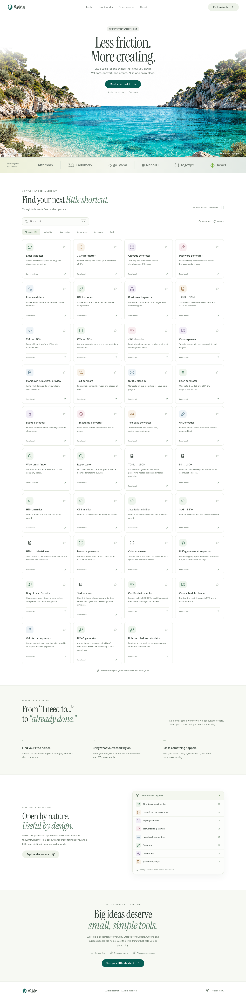
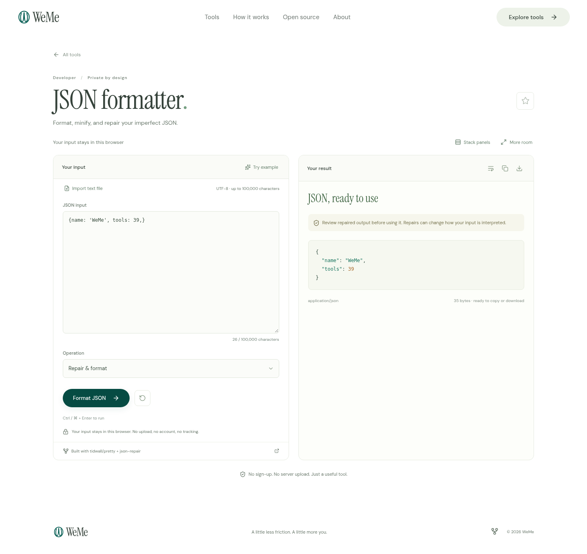
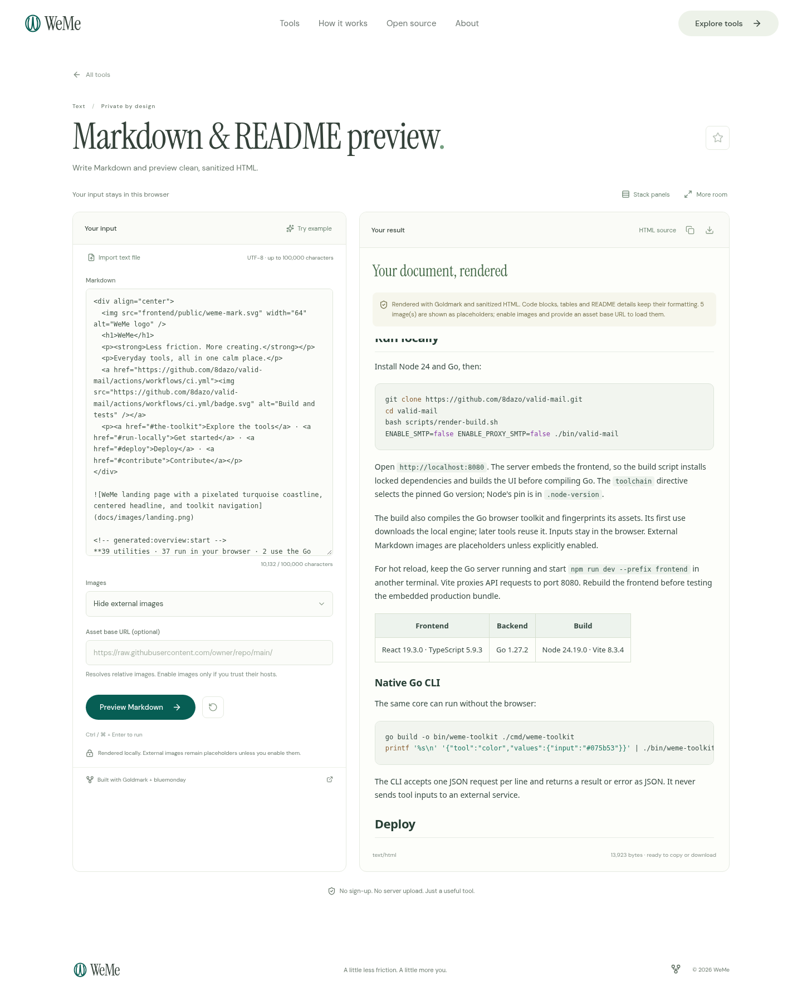

<div align="center">
  
  <h1>WeMe</h1>
  <p><strong>Less friction. More creating.</strong></p>
  <p>Everyday tools, all in one calm place.</p>
  <a href="https://github.com/8dazo/valid-mail/actions/workflows/ci.yml"></a>
  <p><a href="#the-toolkit">Explore the tools</a> · <a href="#run-locally">Get started</a> · <a href="#deploy">Deploy</a> · <a href="#contribute">Contribute</a></p>
</div>



<!-- generated:overview:start -->
**39 utilities · 37 run in your browser · 2 use the Go API**

WeMe is a calm place to validate, convert, and create. It brings practical open-source tools into consistent workspaces, with a coastal landing page, self-hosted fonts, and a React + TypeScript interface.
<!-- generated:overview:end -->

## Made for the small things

- **Find your tool quickly.** Search, categories, favorites, and recent tool IDs.
- **Start with an example.** Clear inputs, useful errors, copy, download, and reset.
- **Use it anywhere.** Responsive workspaces, keyboard navigation, and reduced-motion support.
- **Keep local work local.** Browser utilities don't upload inputs, results, passwords, or tokens.

<details>
  <summary><strong>A closer look at the workspace</strong></summary>
  <br />
  
</details>

<details>
<summary><strong>A readable README preview, including code</strong></summary>
<br />

</details>

<details>
  <summary><strong>Designed for smaller screens, too</strong></summary>
  <br />
  
</details>

## The toolkit

<!-- generated:tools:start -->
| Category | Tools |
| --- | --- |
| Validation | Email validator · Phone validator · URL inspector · IP address inspector · Work email finder · Certificate inspector |
| Conversion | JSON ↔ YAML · XML ↔ JSON · CSV ↔ JSON · Base64 encoder · Timestamp converter · URL encoder · TOML ↔ JSON · INI ↔ JSON · HTML → Markdown · Color converter · Gzip text compressor |
| Generators | QR code generator · Password generator · UUID & Nano ID · Barcode generator · ULID generator & inspector |
| Developer | JSON formatter · JWT decoder · Cron explainer · Hash generator · Regex tester · HTML minifier · CSS minifier · JavaScript minifier · SVG minifier · Bcrypt hash & verify · Cron schedule planner · HMAC generator · Unix permissions calculator |
| Text | Markdown & README preview · Text compare · Text case converter · Text analyzer |

37 tools execute locally. Email validation and work-email discovery call the same-origin API.
<!-- generated:tools:end -->

Each tool links to its upstream library. All utility logic runs in Go: local tools load a reusable WebAssembly worker, while the two email tools call the Go server. See [competitor and Go-package research](docs/competitor-research.md), [tool foundations](docs/tool-research.md), and [third-party notices](docs/third-party.md).

## Run locally

Install Node 24 and Go, then:

```bash
git clone https://github.com/8dazo/valid-mail.git
cd valid-mail
bash scripts/render-build.sh
ENABLE_SMTP=false ENABLE_PROXY_SMTP=false ./bin/valid-mail
```

Open `http://localhost:8080`. The server embeds the frontend, so the build script installs locked dependencies and builds the UI before compiling Go. The `toolchain` directive selects the pinned Go version; Node's pin is in `.node-version`.

The build also compiles the Go browser toolkit and fingerprints its assets. Its first use downloads the local engine; later tools reuse it. Inputs stay in the browser. External Markdown images are placeholders unless explicitly enabled.

For hot reload, keep the Go server running and start `npm run dev --prefix frontend` in another terminal. Vite proxies API requests to port 8080. Rebuild the frontend before testing the embedded production bundle.

<!-- generated:stack:start -->
| Frontend | Backend | Build |
| --- | --- | --- |
| React 19.3.0 · TypeScript 5.9.3 | Go 1.27.2 | Node 24.19.0 · Vite 8.3.4 |
<!-- generated:stack:end -->


### Native Go CLI

The same core can run without the browser:

```bash
go build -o bin/weme-toolkit ./cmd/weme-toolkit
printf '%s\n' '{"tool":"color","values":{"input":"#075b53"}}' | ./bin/weme-toolkit
```

The CLI accepts one JSON request per line and returns a result or error as JSON. It never sends tool inputs to an external service.

## Deploy

| Platform | Setup | Deployment guide |
| --- | --- | --- |
| **Render** | Native Go service; build `bash scripts/render-build.sh`, start `./bin/valid-mail` | [Existing service settings and troubleshooting](docs/render-deployment.md) |
| **Vercel** | Deploy the repository root with `vercel.json` | [Go framework deployment](docs/vercel-deployment.md) |
| **Docker** | Frontend + Go build; static binary in a nonroot distroless image | Commands below |

<details>
  <summary><strong>Run with Docker</strong></summary>

```bash
docker build -t weme .
docker run --rm -p 8080:8080 --read-only --cap-drop=ALL \
  --security-opt=no-new-privileges --memory=512m --cpus=2 \
  -e ENABLE_SMTP=false -e ENABLE_PROXY_SMTP=false weme
```

</details>

Render supplies `PORT`; the server binds to all interfaces. Keep the repository root as the service root. Existing manually configured Render services need their build/start settings updated; a Git push alone doesn't change those settings.

**Mailbox checks need a working SMTP route.** DNS validity checks and SMTP reachability are shown separately. The updated deployment configuration enables SMTP checks. Direct SMTP connections and public proxies were inconclusive in the tested Vercel runtime; configuration alone does not establish a working route. Use a stable private `SMTP_PROXY_URL` when direct port 25 isn't available. Unknown results show “Not measured,” and confidence never guarantees delivery or mailbox ownership. See the [email API documentation](docs/email-service.md).

## Verify your changes

```bash
# Build the exact Render artifact from source.
bash scripts/render-build.sh

# Frontend checks.
npm run format:check --prefix frontend
npm test --prefix frontend
npm audit --prefix frontend

# Go checks.
go test -race -count=1 ./...
go vet ./...
go mod verify

# Keep the built server running before browser checks.
(cd frontend && npx playwright install chromium)
npm run test:e2e --prefix frontend

# Check the README against the actual catalog and version pins.
npm run docs:check
```

GitHub Actions runs the production build, unit tests, audits, race tests, browser checks, and documentation check on pushes and pull requests. The badge above shows current CI status; [validation evidence](docs/validation.md) records what was tested and its limits.

## Privacy and verification

- Optional local storage saves favorite/recent **tool IDs** only. The UI never saves tool inputs or results.
- Email and finder inputs reach the Go server and relevant mail servers or public company pages. Browser utilities execute locally; fonts are self-hosted, with no analytics scripts.
- Email validity checks syntax and mail routing. Null MX means no mail routing; a DNS outage means `unknown`, not `invalid`.
- Phone validation checks numbering rules. JWT decoding doesn't verify signatures.
- Markdown is sanitized; XML DTD/entities are rejected; YAML expansion is bounded; CSV exports escape formulas; generators use cryptographic randomness.

<details>
  <summary><strong>Server configuration</strong></summary>

| Variable | Default | Purpose |
| --- | --- | --- |
| `PORT` | `8080` | Internal HTTP port |
| `VERIFY_MAX_CONCURRENCY` | `8` | Concurrent email checks |
| `ENABLE_SMTP` | `true` | Direct SMTP, requiring outbound port 25; enabled in the Render Blueprint; runtime egress must support it |
| `SMTP_PROXY_URL` | empty | Private SOCKS5 route; store credentials securely |
| `SMTP_TOTAL_TIMEOUT` | `25s` | Total mailbox-check budget |
| `ENABLE_PROXY_SMTP` | `false` | Optional public SOCKS5 pool |
| `AUTO_UPDATE_DISPOSABLE` | `false` | Optional disposable-domain list updates |
| `TRUST_PROXY` | `false` | Trust client-IP headers only behind a proxy that overwrites them |

Rate limits allow 30 email checks and 10 discovery requests per IP per minute. These limits apply per instance; use a shared edge quota for multiple replicas. Requests, concurrency, caches, and network timeouts are bounded. The server handles SIGTERM/SIGINT with graceful shutdown.

</details>

## Contribute

Add tool metadata to `frontend/src/catalog.ts`, implement a thin Go wrapper in `internal/toolkit`, and register it in the Go dispatcher. Choose a tested Go library or standard-library API and include meaningful correctness and boundary cases. The TypeScript layer handles UI and calls the Go worker. Then run:

```bash
npm run docs:update
npm run docs:check
```

The README's catalog, tool counts, and stack versions come directly from source. CI rejects stale generated sections. Update screenshots when the design changes, and document platform settings alongside changes to deployment files. After dependency changes, rebuild notices with `python3 scripts/update-licenses.py`.

Useful links: [Render guide](docs/render-deployment.md) · [Vercel guide](docs/vercel-deployment.md) · [Email service](docs/email-service.md) · [Validation](docs/validation.md) · [Credits and licenses](docs/third-party.md).

<details>
  <summary><strong>Codex cloud development</strong></summary>

On the prepared cloud machine, first source `/workspace/.cloud/weme/activate.sh` to select the verified Go compiler and writable caches. The helper `python3 scripts/cloud-docker-build.py` supports the injected HTTPS proxy without retaining its credentials. Native DNS/outbound connectivity is limited in this instance, so public email/finder requests can remain inconclusive even when local tools and process health work. Test external workflows on the target hosting platform.

</details>
